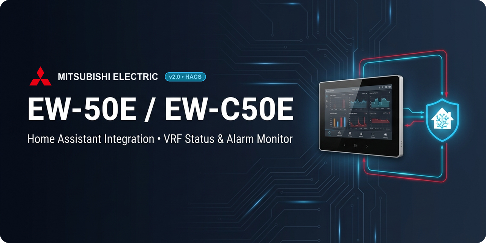

<p align="center">
  
</p>

<p align="center">
  <a href="https://github.com/hacs/integration"></a>
  <a href="https://github.com/gabrio79/Mitsubishi-EW-50E-EW-C50E/releases"></a>
  
</p>

# Mitsubishi EW-50E / EW-C50E — Integrazione Home Assistant

Integrazione **custom** (HACS) per i controller centralizzati **Mitsubishi Electric EW-50E / EW-C50E**.
Comunica in locale via **WebSocket + XML** (`local_polling` / 30 s) e monitora **stati e anomalie** dell'impianto VRF/M-NET.

> ℹ️ **Versione semplificata (1.15+)**: l'integrazione si concentra su **stati di funzionamento e allarmi/anomalie**.
> Non vengono più create entità di temperatura o setpoint — quei dati non vengono più letti né dal device né esposti.

---

## ✨ Funzionalità

- 🔌 Connessione **100% locale** (nessun cloud) via WebSocket sicuro (`wss://` con subprotocollo `b_xmlproc`)
- 🔎 **Auto-discovery** dei gruppi attivi e dei nomi (`GroupNameWeb` via `ControlGroup/MnetList`)
- 🚦 Stato di ogni zona/gruppo (`ON - <modalità>`, `OFF`, `ERRORE`)
- 🛡️ Allarmi di **sistema**, **per gruppo** (`AlarmCode`) e **perdita gas refrigerante**
- 🔢 Conteggio degli allarmi attivi
- 🎨 **Icone e loghi nativi integrati** (`custom_components/ew50e/brand/` con supporto Light/Dark mode e HiDPI `@2x`)
- 📲 Package pronto per **notifiche Telegram** su anomalia/rientro/offline
- 📊 Dashboard Lovelace pronta all'uso (Mushroom + auto-entities)

---

## 📦 Installazione

### Via HACS (consigliato)

[](https://my.home-assistant.io/redirect/hacs_repository/?owner=gabrio79&repository=Mitsubishi-EW-50E-EW-C50E&category=integration)

Oppure manualmente da HACS:
1. HACS → **Integrazioni** → menu ⋮ → **Repository personalizzati**
2. Aggiungi `https://github.com/gabrio79/Mitsubishi-EW-50E-EW-C50E` come categoria **Integrazione** (`Integration`)
3. Installa **Mitsubishi EW-50E / EW-C50E** e **riavvia** Home Assistant

### Manuale
Copia la cartella dell'integrazione in `config/custom_components/ew50e/` e riavvia HA.

### Configurazione
**Impostazioni → Dispositivi e servizi → Aggiungi integrazione → EW-50E** e inserisci:

| Campo | Esempio | Note |
|-------|---------|------|
| Indirizzo IP | `192.168.50.72` | IP locale del controller |
| Username | `initial` | utente dell'interfaccia web |
| Password | `••••••` | password dell'interfaccia web |

---

## 🧩 Dispositivi ed Entità create

L'integrazione organizza l'impianto in modo ordinato creando **1 dispositivo centrale (`EW50E`)** per la diagnostica globale + **1 dispositivo dedicato per ciascuna zona M-NET** (collegato via `via_device`), mantenendo gli `entity_id` puliti senza prefissi superflui di area o hub:

### Dispositivo Centrale (`EW50E`)
| Entità | Tipo | Descrizione |
|--------|------|-------------|
| `sensor.ew50e_stato_sistema` | sensor | Stato globale (`NORMALE` / `ALLARME` / stato M-NET) |
| `sensor.ew50e_allarmi_attivi` | sensor | Numero di allarmi attivi (con dettaglio negli attributi) |
| `binary_sensor.ew50e_anomalia_sistema` | binary (problem) | Anomalia di sistema o allarmi presenti |
| `binary_sensor.ew50e_perdita_gas_refrigerante` | binary (gas) | Allarme perdita refrigerante |

### Dispositivo per singola Zona (es. `Studio 2 - Savernini`, `Farmacia - Bancone`, …)
| Entità | Tipo | Descrizione |
|--------|------|-------------|
| `sensor.<zona>_stato` | sensor | `ON - <modalità>` / `OFF` / `ERRORE` (espone `gruppo_id`, `macro_zona`, `nome_breve`, `segnalazione_filtro`) |
| `binary_sensor.<zona>_anomalia` | binary (problem) | Errore o allarme della zona (espone `gruppo_id`, `macro_zona`, `nome`, `codice_errore`) |

> Le zone si auto-rilevano: gli attributi `gruppo_id`, `macro_zona` e `nome_breve` permettono a package e dashboard di raggrupparle automaticamente senza cablare i nomi a mano.

---

## 📲 Notifiche Telegram (package)

Il file [`packages/ew50e_telegram.yaml`](packages/ew50e_telegram.yaml) aggiunge:

- due entità di aggregazione — `binary_sensor.ew50e_problema_globale` e `sensor.ew50e_problemi_totali`;
- tre automazioni che notificano su `notify.telegram_nome_del_tuo_bot`:
  - 🚨 **Nuova anomalia** — quando il numero di problemi aumenta (elenca sistema/gas/zone + codici errore);
  - ✅ **Rientro** — quando tutto torna normale;
  - 📡 **Offline** — se l'integrazione resta `unavailable` per 5 minuti.

**Attivazione** — in `configuration.yaml`:
```yaml
homeassistant:
  packages: !include_dir_named packages
```
poi copia il file in `<config>/packages/` e riavvia. Assicurati di sostituire `notify.telegram_nome_del_tuo_bot` all'interno del file YAML con il nome reale del tuo servizio di notifica Telegram (es. `notify.telegram_bot_id_chat_id`).

---

## 📊 Dashboard Lovelace

Il file [`dashboards/ew50e.yaml`](dashboards/ew50e.yaml) fornisce una vista organizzata con banner di stato, riepilogo a chip, card **Anomalie attive** in cima (visibile solo in caso di guasto) e **4 card separate per Macro-Zona** (*Farmacia*, *Studi*, *Casa*, *Bilocale*).

**Componenti HACS (Frontend) richiesti:** [Mushroom](https://github.com/piitaya/lovelace-mushroom) e [auto-entities](https://github.com/thomasloven/lovelace-auto-entities).

Registra la dashboard in `configuration.yaml`:
```yaml
lovelace:
  dashboards:
    ew50e-dashboard:
      mode: yaml
      title: Clima EW-50E
      icon: mdi:air-conditioner
      show_in_sidebar: true
      filename: dashboards/ew50e.yaml
```

---

## 🔐 SSL

Il certificato SSL dell'EW-50E è **self-signed**: la verifica è disabilitata intenzionalmente.

## 🔧 Comunicazione XML
Il sistema usa messaggi XML su WebSocket con tre tipi di comando:

| Comando | Direzione | Uso |
|---------|-----------|-----|
| `getRequest` | Client → Server | Richiesta dati |
| `getResponse` | Server → Client | Risposta a una richiesta |
| `notifyRequest` | Server → Client | Aggiornamento spontaneo (es. cambio stato/allarme) |

### Auto-discovery gruppi
All'avvio l'integrazione interroga `<ControlGroup><MnetList /></ControlGroup>` per leggere i gruppi configurati e i rispettivi nomi web (`GroupNameWeb`), utilizzando il dizionario `KNOWN_GROUP_NAMES` in `__init__.py` come fallback qualora un gruppo non abbia etichetta impostata sul controller.

### Lettura dati
Ad ogni ciclo (ogni 30 s) viene richiesto in batch lo stato dei gruppi più gli allarmi (`AlarmStatusList` e `SystemAlarm`):
```xml
<Packet>
  <Command>getRequest</Command>
  <DatabaseManager>
    <Mnet Group="1" Drive="*" Mode="*" AirDirection="*" FanSpeed="*" ErrorSign="*" FilterSign="*" />
  </DatabaseManager>
</Packet>
```
Vengono letti esclusivamente gli attributi di **stato/anomalia** (`Drive`, `Mode`, `FanSpeed`, `AirDirection`, `ErrorSign`, `FilterSign`, `AlarmCode`); `SetTemp`/`InletTemp`/`OATemp` non vengono richiesti.

### Allarmi
Gli allarmi sono disponibili tramite tre meccanismi:
- `<SystemAlarm Alert="ON">` → allarme globale di sistema
- `<AlarmStatusList><AlarmStatusRecord>` → lista allarmi per gruppo
- `<RefUnit ErrorSign="ON">` → errori unità refrigeranti

---

## 🐛 Debug

Per verificare il protocollo WS direttamente dal browser, apri la console JS sull'interfaccia EW-50E e incolla:

```javascript
const OrigWS = WebSocket;
window.WebSocket = function(...a) {
  const ws = new OrigWS(...a);
  ws.addEventListener('message', e => console.log('WS MSG:', e.data));
  return ws;
};
```
Poi ricarica la pagina con **F5** — i messaggi XML appariranno in console.

Per i log di Home Assistant, cerca `custom_components.ew50e` nel log di sistema. Per log più verbosi:
```yaml
logger:
  logs:
    custom_components.ew50e: debug
```

---

## 📋 Requisiti

- Home Assistant 2026.1 o superiore
- EW-50E / EW-C50E raggiungibile sulla rete locale
- Python `aiohttp >= 3.8.0` (installato automaticamente)
- *(opzionale)* HACS Frontend: Mushroom + auto-entities per la dashboard

---

## 📄 Licenza

MIT License — vedi [LICENSE](LICENSE) per i dettagli.
